<div align="center">

# 🩺 MedPro All In One

**Plugin Obsidian untuk dokter & mahasiswa kedokteran Indonesia:** penyakit SKDI 2019, **atlas anatomi 3D**, pemeriksaan fisik, database obat, CPPT, jaga & SBAR, resep, lab & AGD, EKG, antidot — semua di satu tempat dan **bekerja tanpa internet**.


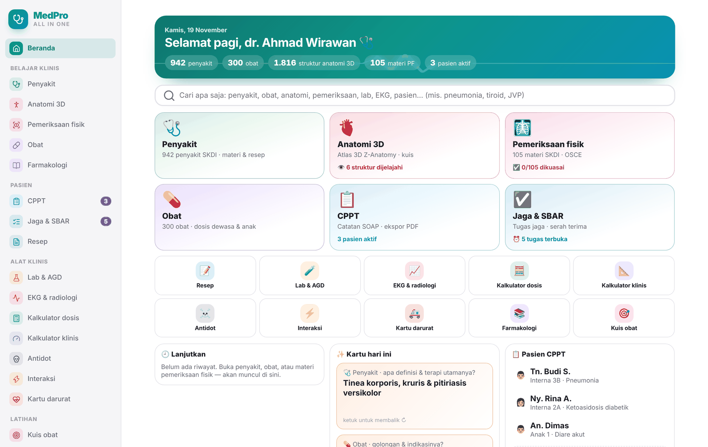

</div>

---

## ✨ Fitur

| Bagian | Isi |
|---|---|
| 🏠 **Beranda** | Pencarian universal (penyakit, obat, anatomi, pemeriksaan, nilai lab, irama EKG, pasien), pasien CPPT aktif, tugas jaga, kartu hafalan harian |
| 🦠 **Penyakit** | Materi lengkap **942 penyakit** (semua 913 penyakit SKDI 2019 + 29 penyakit THT): definisi, gambaran klinis, diagnosis & pemeriksaan fisik, tata laksana, resep per penyakit, edukasi pasien — kini dengan **anatomi terkait** |
| 🫀 **Atlas anatomi 3D** | Model 3D **Z-Anatomy** (turunan BodyParts3D): **8 lapisan** (kulit, otot, tulang, sendi & ligamen, jantung & pembuluh, saraf & indra, organ dalam, limfoid), **±1.800 struktur / 3.169 objek 3D**. Putar, perbesar, ketuk, sembunyikan, isolasi, **tembus pandang (X-ray)**, **potongan koronal/sagital/aksial**, warna fungsi otot & lobus otak, hierarki Terminologia Anatomica. Nama Indonesia/Latin, **166 materi Indonesia** (fungsi, klinis, penyakit terkait, cara memeriksa), definisi Wikipedia, **Kuis tunjuk 3D** & **Kuis nama 3D**, buat flashcard |
| 🔍 **Pemeriksaan fisik** | 105 materi SKDI 2019, 286 keterampilan, Mode OSCE, kuis temuan, tautan ke anatomi |
| 💊 **Obat & farmakologi** | 300 obat (dosis dewasa & anak dicocokkan BNF 85, kontraindikasi, kehamilan, ginjal, edukasi), 38 golongan farmakologi, kuis obat |
| 📋 **CPPT** | SOAP, tanda vital & tren, diagnosis ICD-10, sisip resep, peringatan alergi, **ekspor PDF** |
| 🔁 **Jaga & SBAR** | Tugas jaga dengan jam & **pengingat**, prioritas, tunda 30 menit; **SBAR otomatis dari CPPT** (tren tanda vital, terapi, tugas tertunda), catatan shift, **PDF serah terima** |
| 📝 **Resep** | Format resep Indonesia, dosis anak otomatis dari BB, puyer, **ekspor PDF** |
| 🧪 **Lab & AGD** | Analisis gas darah bertahap (status pH, gangguan primer & campuran, kompensasi Winter, anion gap terkoreksi albumin, delta ratio, P/F, gradien A-a), koreksi Na/Ca, osmolalitas, defisit air bebas, tabel Adrogué-Madias, kalium, defisit bikarbonat, **82 nilai rujukan** |
| 📈 **EKG & radiologi** | Panduan baca EKG sistematis, **16 irama** dengan strip EKG, kuis irama, kalkulator laju, **QTc** (Bazett/Fridericia/Framingham) & **aksis**; foto toraks skematis 6 kondisi, panduan ABCDE, CTR, templat laporan |
| ☠️ **Antidot** | **22 kalkulator antidot**: nalokson, atropin, pralidoksim, flumazenil, bikarbonat, kalsium, insulin dosis tinggi, glukagon, emulsi lipid, digoxin-Fab, fomepizol/etanol, deferoksamin, vitamin K/protamin/idarusizumab, hidroksokobalamin, metilen biru, dekstrosa/oktreotid, piridoksin, magnesium, dantrolen, levokarnitin, serum antibisa ular (SABU), **N-asetilsistein** |
| 🧮 **Kalkulator** | Kalkulator dosis (mL, tablet, syringe pump, CrCl/eGFR), kalkulator klinis (skor, konversi opioid/steroid), cek interaksi (aturan kurasi + 588 pasangan BNF 85), kartu darurat anak (PALS) |

Tampilan menyesuaikan layar: menu samping di desktop, ikon ringkas di layar sedang, dan **menu laci (☰)** di HP.

<table>
<tr><td>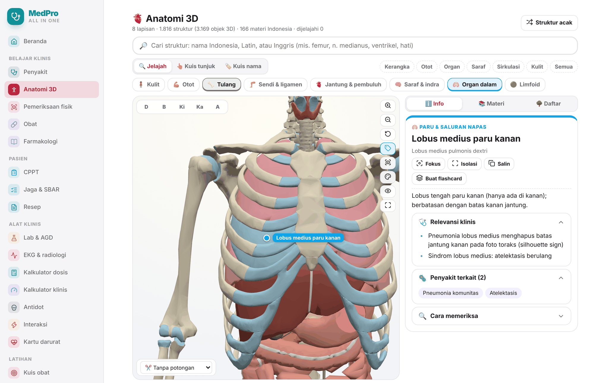</td><td>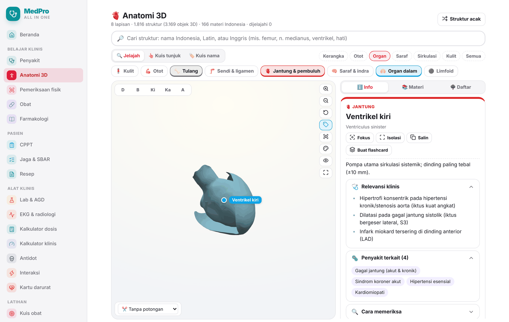</td></tr>
<tr><td>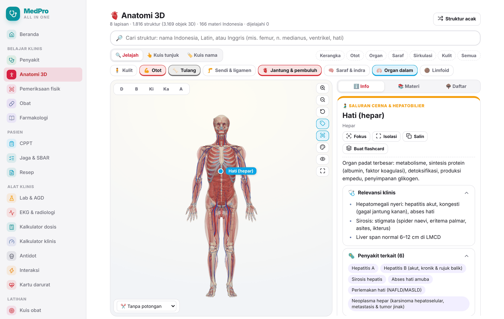</td><td>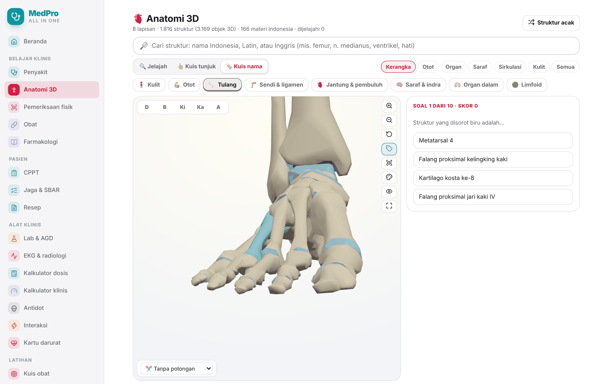</td></tr>
<tr><td>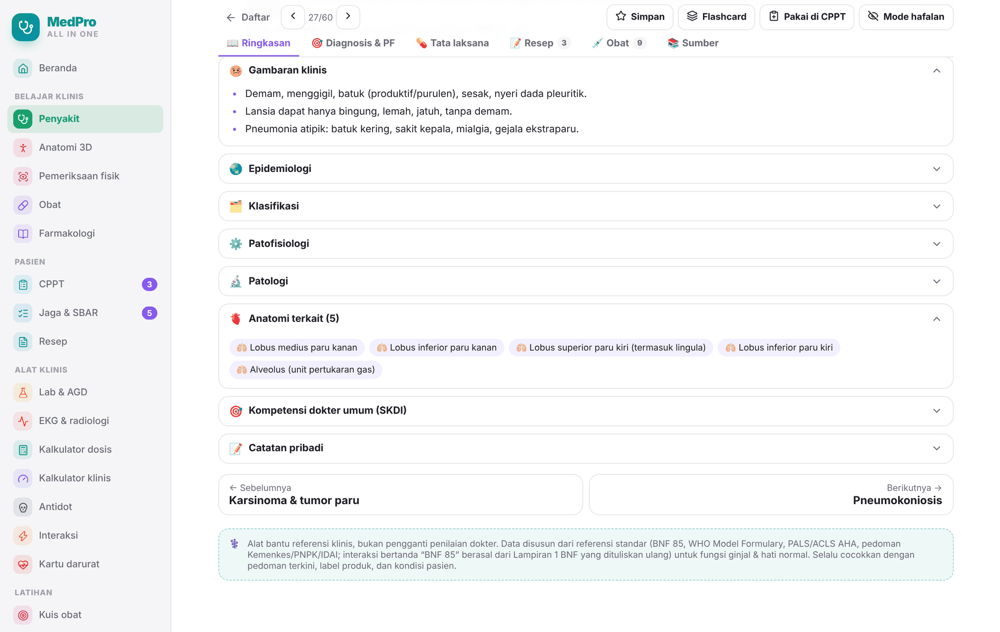</td><td>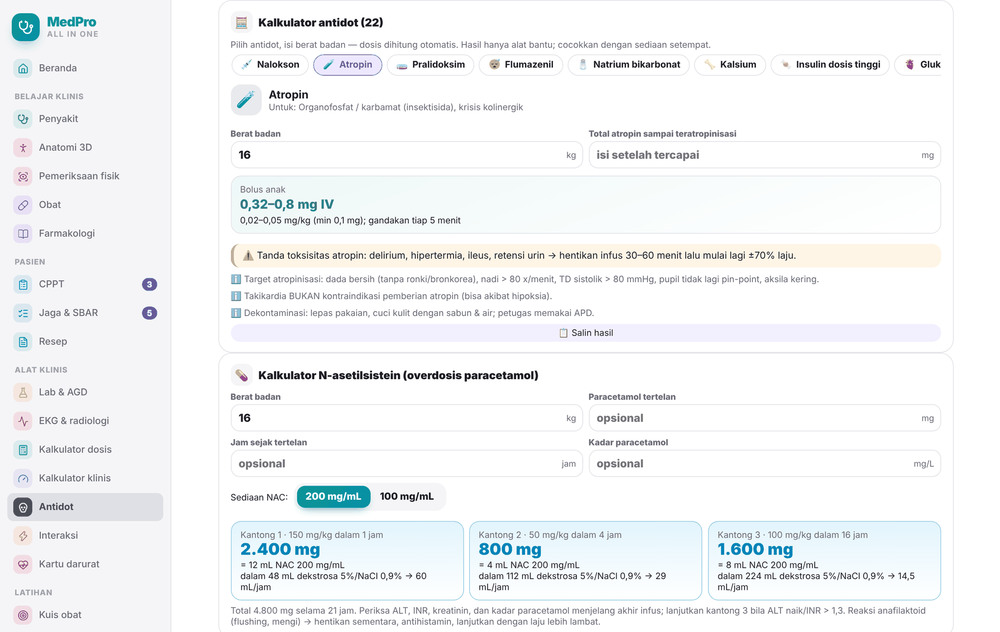</td></tr>
<tr><td>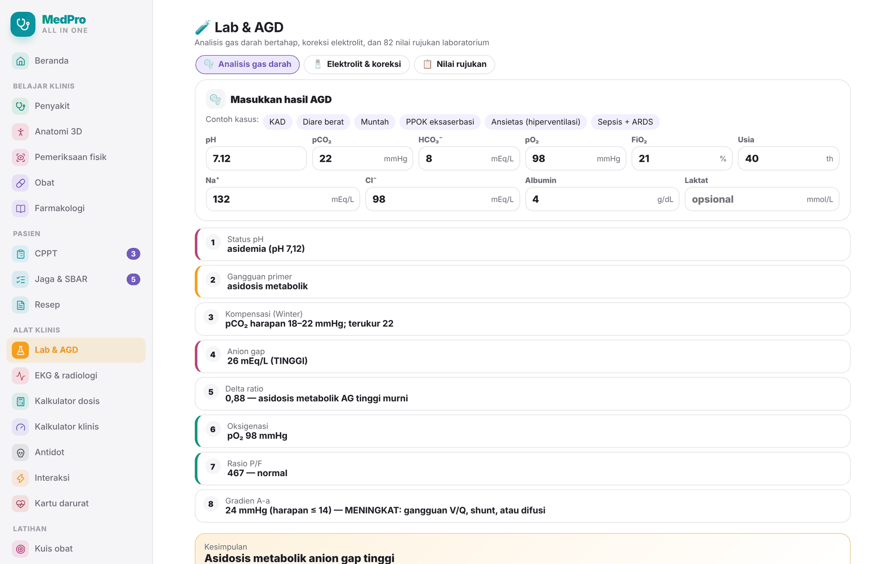</td><td>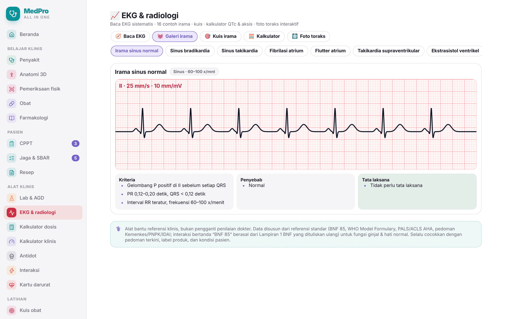</td></tr>
<tr><td>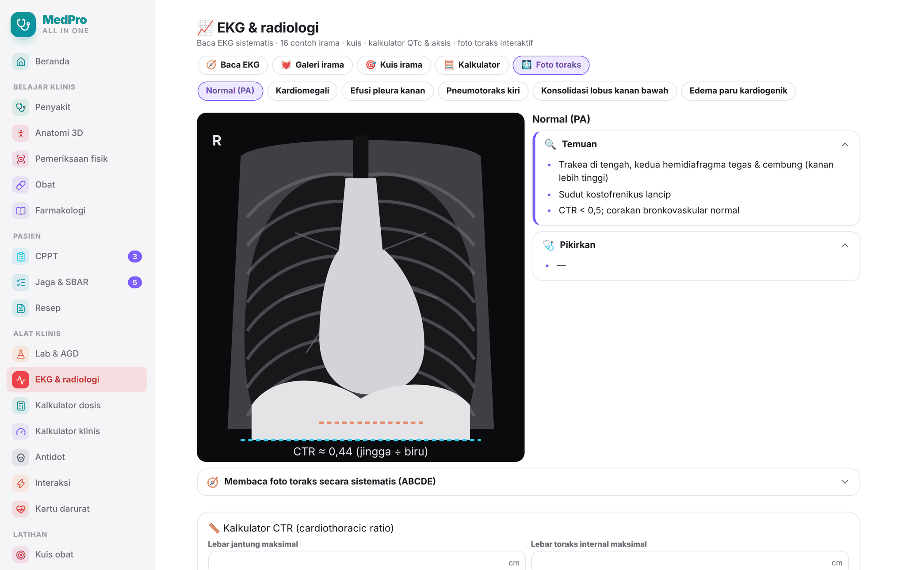</td><td>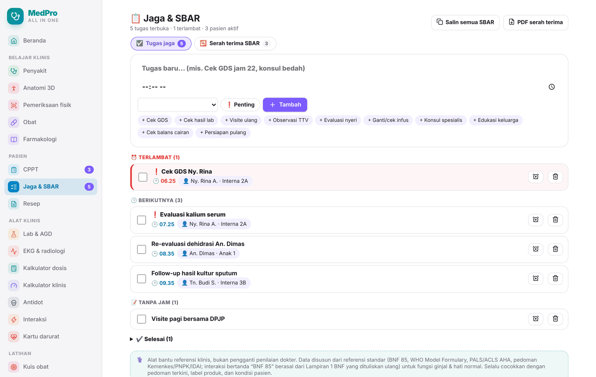</td></tr>
<tr><td>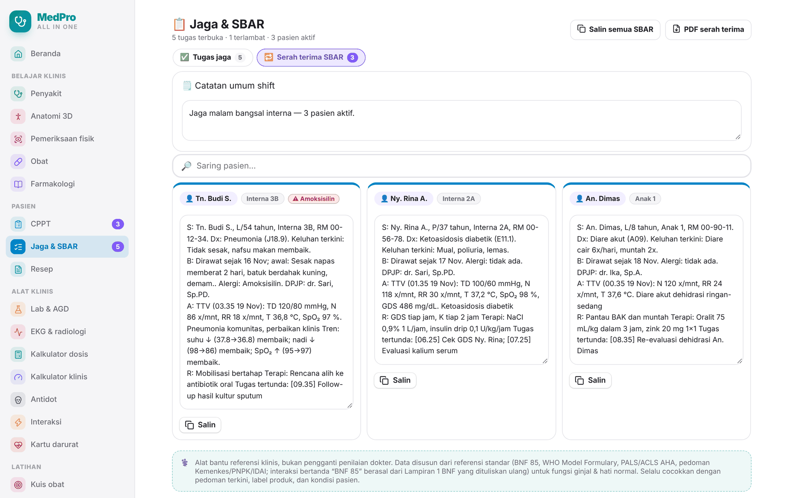</td><td>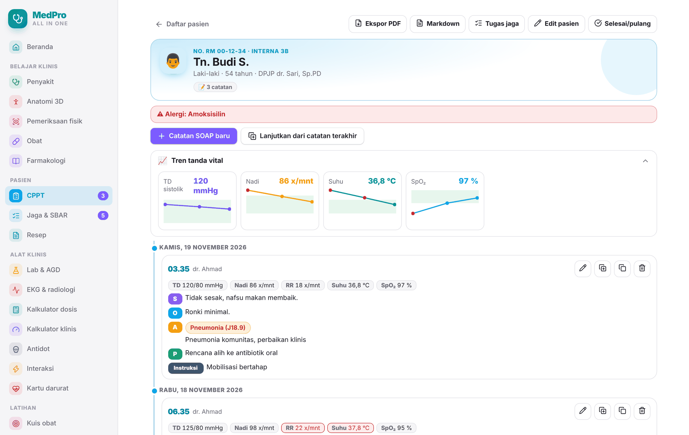</td></tr>
<tr><td colspan="2">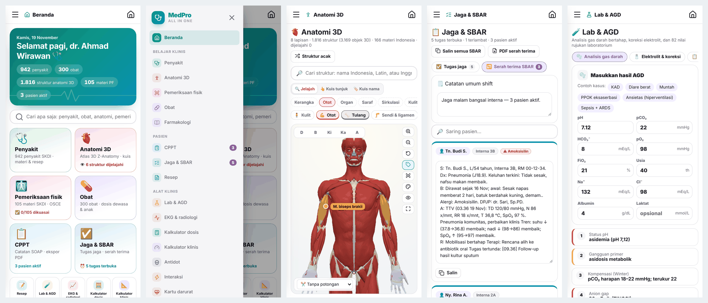</td></tr>
</table>

## 📦 Instalasi

### Lewat BRAT
1. Pasang plugin **BRAT** dari *Settings → Community plugins → Browse*.
2. Buka *Settings → BRAT → Add Beta plugin*.
3. Masukkan `ahmadwirawan74-ui/medpro-all-in-one`, lalu aktifkan **MedPro All In One**.

### Manual
1. Unduh `main.js`, `manifest.json`, dan `styles.css` dari [Release terbaru](https://github.com/ahmadwirawan74-ui/medpro-all-in-one/releases/latest).
2. Salin ketiganya ke `<vault>/.obsidian/plugins/medpro-all-in-one/`.
3. Muat ulang Obsidian, lalu aktifkan plugin di *Settings → Community plugins*.

Buka MedPro lewat ikon 🩺 di ribbon atau perintah **"MedPro All In One: Buka MedPro"**. Setiap bagian juga punya perintah sendiri (mis. *MedPro All In One: Buka Anatomi 3D*).

## 🔄 Pindah dari Flashcard Hafalan

Fitur Medis sebelumnya ada di plugin **Flashcard Hafalan**. Mulai Flashcard Hafalan 23.0.0, semuanya pindah ke MedPro.

Data lama **tidak hilang**. Saat MedPro pertama dibuka, muncul tombol **Impor sekarang** yang menyalin pasien & catatan CPPT, obat favorit, catatan pribadi, identitas dokter, progres pemeriksaan fisik, dan riwayat dari `flashcard-hafalan/data.json`. Impor bisa diulang kapan saja di *Settings → MedPro All In One → Impor dari Flashcard Hafalan* — data digabung tanpa menduplikasi.

## 🔒 Privasi

- Semua data (pasien CPPT, catatan, tugas jaga, progres) tersimpan **lokal** di `.obsidian/plugins/medpro-all-in-one/data.json`. Tidak ada telemetri, tidak ada akun, dan **tidak ada akses jaringan**.
- **Jangan pernah mengunggah `data.json`** ke GitHub atau tempat publik lain, karena berisi data pasien. `.gitignore` di repo ini sudah mengabaikannya.
- Cadangan JSON (*Settings → MedPro All In One → Cadangkan data*, disimpan di folder `MedPro/`) dan PDF CPPT/resep/serah terima disimpan di vault kamu sendiri — perlakukan sebagai dokumen medis rahasia.

## ⚕️ Penafian

MedPro adalah **alat bantu referensi dan belajar**, bukan pengganti penilaian klinis dokter. Dosis, interaksi, dan interpretasi harus selalu dicocokkan dengan pedoman terkini, label produk, dan kondisi pasien. Diagram anatomi bersifat skematis untuk belajar, bukan atlas presisi.

## 📚 Sumber & lisensi pihak ketiga

Materi medis ditulis ulang dengan bahasa sendiri dari referensi standar (SKDI 2019 KKI, PNPK/PPK Kemenkes, BNF 85, Macleod's Clinical Examination, Bates' Guide, CMDT, Moore *Clinically Oriented Anatomy*, Netter, Snell, Sobotta). Diagram anatomi dan strip EKG digambar sendiri secara prosedural.

**Model 3D anatomi** berasal dari [Z-Anatomy](https://github.com/Z-Anatomy/Models-of-human-anatomy) (Gauthier Kervyn, Marcin Zielinski), turunan [BodyParts3D](https://dbarchive.biosciencedbc.jp/en/bodyparts3d/download.html) © The Database Center for Life Science (CC BY-SA 2.1 JP). Model disederhanakan (decimate) dan dikonversi untuk MedPro, lalu **dibagikan ulang dengan lisensi CC BY-SA 4.0** — lihat [`assets/LICENSE-anat3d.md`](assets/LICENSE-anat3d.md). Definisi struktur berasal dari Wikipedia (CC BY-SA). Sebagian kecil model yang diadaptasi Z-Anatomy (ginjal, telinga dalam) berlisensi **NonCommercial**, jadi MedPro tidak boleh dijual.

Ekspor PDF memakai [jsPDF](https://github.com/parallax/jsPDF) (MIT), tampilan 3D memakai [three.js](https://threejs.org) (MIT), dan dekompresi memakai [fflate](https://github.com/101arrowz/fflate) (MIT). Rincian di [THIRD_PARTY_NOTICES.md](THIRD_PARTY_NOTICES.md) dan folder [`licenses/`](licenses/).

## 🛠️ Pengembangan

```bash
npm install
./build-css.sh  # gabungkan css/*.css → styles.css
npm run dev     # build otomatis saat file berubah
npm run build   # build produksi → main.js
```

Aset atlas 3D (`assets/anat3d.bin`) dibuat dari model Z-Anatomy oleh pipeline di [`tools/anat3d-pipeline/`](tools/anat3d-pipeline/README.md) (Blender sebagai modul Python). Nama Indonesia dan materi dibuat ulang dengan:

```bash
python3 tools/anat3d_names.py -w     # nama Indonesia → src/anat3d-names.ts
python3 tools/anat3d_content.py -w   # materi Indonesia ↔ struktur 3D → src/anat3d-content.ts
```

**Merilis versi baru:** `npm version patch` (atau `minor`/`major`), lalu `git push && git push --tags`. GitHub Actions membangun plugin dan membuat Release berisi `main.js`, `manifest.json`, dan `styles.css`.

## 📄 Lisensi

Kode plugin berlisensi [MIT](LICENSE). Aset model 3D (`assets/anat3d.bin`, termasuk salinannya yang tertanam di `main.js`) dan daftar nama strukturnya berlisensi [CC BY-SA 4.0](licenses/CC-BY-SA-4.0-legalcode.txt).
